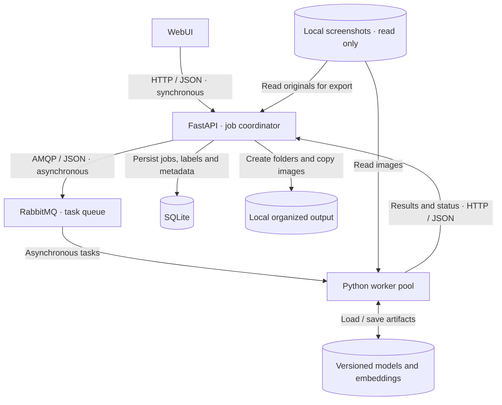
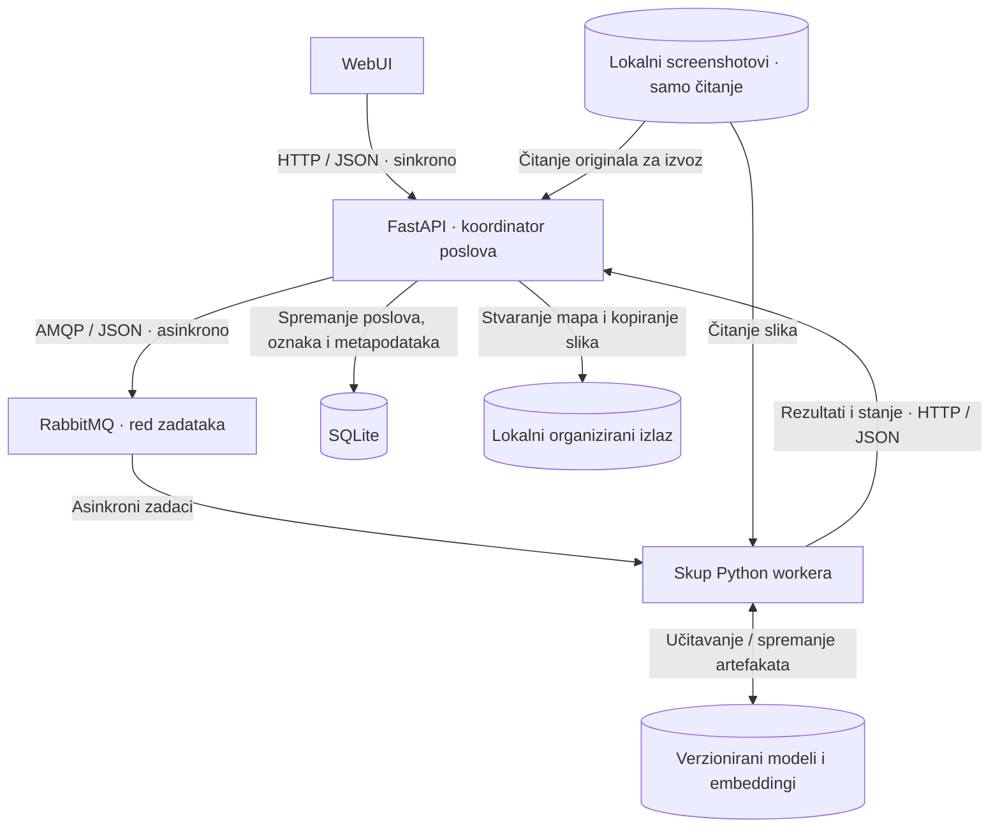

# ScreenshotSort

ScreenshotSort
[English](#about---english) · [Hrvatski](#opis---hrvatski)

## About - English

ScreenshotSort is a local web application being developed to organize mixed collections of video game screenshots into game-specific folders. Users define their games, label representative screenshots, and prepare a personalized classifier. Independent Python workers process the remaining images in parallel.

Features and workflow
1. Choose a collection. Select a folder within the local input directory configured for Docker.
2. Define games. Configure 2–5 categories and label reference screenshots for each game, or use available starter presets.
3. Prepare the classifier. Combine relevant starter examples with personal references and train a small classifier locally.
4. Run sorting. Select the games to export and choose 1–4 active workers. Follow batch progress and pause, resume, or cancel processing.
5. Review results. Correct labels and inspect uncertain predictions. FastAPI copies screenshots into game-specific output folders; originals remain unchanged.

The WebUI provides a guided setup, light/dark themes, and an operator panel for worker health, queue status, errors, retries, and profile reset. Resetting the profile removes personal categories and custom models while preserving original screenshots and existing exports.
Architecture

One Docker Compose project runs seven containers: one WebUI, one API, one RabbitMQ instance, and four worker containers. Two workers are active by default. The WebUI changes how many existing workers participate; it does not create or remove containers. SQLite and model files use local persistent storage rather than separate services.

RabbitMQ distributes image-level tasks. Workers extract features and predict labels; FastAPI owns database writes and output file operations. Training is a separate task handled by one worker, and every sorting batch uses a fixed model version. Queue messages carry identifiers and file references, not image contents.
Tech stack

| Layer | Technologies |
|---|---|
| WebUI | HTML, JavaScript, Bootstrap 5 |
| API and coordination | Python, FastAPI, asyncio |
| Messaging and worker communication | RabbitMQ |
| Machine learning | PyTorch, Hugging Face Transformers / CLIP, scikit-learn |
| Image processing and model artifacts | Pillow, NumPy |
| Storage and deployment | SQLite, local bind mounts / volumes, Docker Compose |

Machine learning
- A pretrained CLIP image encoder produces visual embeddings. Its weights remain frozen. A small logistic regression classifier is trained on labeled embeddings to distinguish the configured games.

- The initial plan includes author-trained presets for Genshin Impact, The Legend of Zelda: Breath of the Wild, and GTA V ( among other possible candidates ). Users can add their own games and examples. Updating categories retrains the small classifier on the relevant existing and new examples; it does not retrain CLIP. Saved classifiers and references are reused across restarts.

- Uncertain predictions are routed to a review folder. Recognition of games outside the configured categories is not guaranteed. Accuracy depends on the visual similarity of games and the quality and diversity of reference images; a few examples may be insufficient.
Local use and data
Deployment targets a local computer with Docker and Docker Compose. Setup will configure input/output directories, start the stack, and expose the WebUI on localhost. Installation commands will be documented with the first working release.

The folder browser in the WebUI lists directories available to the backend through configured mounts. It does not grant access to arbitrary host folders. PNG/JPEG originals, embeddings, models, and results stay on the Docker host; image processing uses no external AI API. Installation may require downloading model weights and dependencies.

Output is organized by batch and game, with a separate review folder. Pause lets in-flight images finish before stopping new work; cancel also cancels pending tasks. Completed exports are preserved.
Distributed systems scope - This is a solo project for the Distributed Systems course at the Faculty of Informatics in Pula. Its focus is isolating expensive feature extraction from the API, distributing tasks, and recovering from worker failures.
- Reliability: durable messages, manual acknowledgements after confirmed completion, bounded retries, and idempotent results/output. Computation can repeat after a failure without creating duplicate final results.
- Scaling evaluation: compare 1, 2, and 4 active workers on the same dataset; the planned workload is 1,000 screenshots up to 4K resolution. Measure processing time, throughput, CPU, and RAM, and demonstrate recovery after stopping a worker. No benchmark results are available yet.
- Limits: one local profile and one active training/sorting job. CPU, memory, disk, API/export, and SQLite can limit throughput; additional workers do not guarantee proportional speedup.
- Deployment boundary: independent containers run on one physical host. API, broker, and storage high availability are outside the initial scope; multiple physical hosts would require shared or network-accessible file/model storage.

#### Author: Mario Bariša

## Opis - Hrvatski

ScreenshotSort je lokalna web-aplikacija za organiziranje pomiješanih screenshotova videoigara u zasebne mape prema igrama. Korisnik definira igre, označava reprezentativne screenshotove i priprema prilagođeni klasifikator. Neovisni Python workeri paralelno obrađuju preostale slike.

Funkcionalnosti i način korištenja
1. Odabir kolekcije. Korisnik odabire mapu unutar lokalnog ulaznog direktorija konfiguriranog za Docker.
2. Definiranje igara. Postavlja 2–5 kategorija i označava referentne screenshotove za svaku igru ili koristi dostupne početne predloške.
3. Priprema klasifikatora. Relevantni početni primjeri kombiniraju se s korisnikovim referencama te se lokalno trenira mali klasifikator.
4. Razvrstavanje. Korisnik bira igre za izvoz i 1–4 aktivna workera. Prati napredak batcha te može pauzirati, nastaviti ili prekinuti obradu.
5. Pregled rezultata. Ispravlja oznake i pregledava nesigurne predikcije. FastAPI kopira screenshotove u izlazne mape prema igrama; originali ostaju nepromijenjeni.
WebUI sadrži vođeno postavljanje, svijetlu/tamnu temu i upravljački panel za stanje workera, red zadataka, pogreške, ponovne pokušaje i reset profila. Reset uklanja korisničke kategorije i prilagođene modele, uz očuvanje originalnih screenshotova i postojećih izvoza.

## Arhitektura

Jedan Docker Compose projekt pokreće sedam kontejnera: WebUI, API, RabbitMQ i četiri worker kontejnera. Zadano su aktivna dva workera. WebUI mijenja broj uključenih postojećih workera; ne stvara niti uklanja kontejnere. SQLite i datoteke modela koriste lokalnu trajnu pohranu umjesto zasebnih servisa.

RabbitMQ raspoređuje zadatke po slikama. Workeri izdvajaju obilježja i predviđaju oznake; FastAPI je vlasnik upisa u bazu i datotečnih operacija izvoza. Treniranje je zaseban zadatak jednog workera, a svaki batch koristi fiksnu verziju modela. Poruke sadrže identifikatore i reference na datoteke, ne sadržaj slika.
## Tehnologije

| Sloj | Tehnologije |
|---|---|
| WebUI | Bootstrap 5 ili DaisyUI, Vue ili Flask |
| API i koordinacija | Python, FastAPI, asyncio |
| Poruke i komunikacija workera | RabbitMQ |
| Strojno učenje | PyTorch, Hugging Face Transformers / CLIP, scikit-learn |
| Obrada slika i artefakti modela | Pillow, NumPy, joblib |
| Pohrana i pokretanje | SQLite, lokalni bind mountovi / volumei, Docker Compose |

## Strojno učenje
Gotovi CLIP image encoder izdvaja vizualne embeddinge. Njegove težine ostaju nepromijenjene. Na označenim embeddingima trenira se mali klasifikator logističke regresije koji razlikuje konfigurirane igre.

Početno su planirani autorovi istrenirani predlošci za Genshin Impact, The Legend of Zelda: Breath of the Wild i GTA V ( ili druge igre-> vidit ću ). Korisnik može dodati vlastite igre i primjere. Pri izmjeni kategorija ponovno se trenira mali klasifikator na relevantnim postojećim i novim primjerima; CLIP se ne trenira ponovno. Spremljeni klasifikatori i reference koriste se i nakon ponovnog pokretanja.

Nesigurne predikcije izdvajaju se u mapu za provjeru. Prepoznavanje igara izvan konfiguriranih kategorija nije zajamčeno. Točnost ovisi o vizualnoj sličnosti igara te kvaliteti i raznolikosti referentnih slika; nekoliko primjera može biti nedovoljno.
Lokalno korištenje i podaci
Aplikacija je namijenjena lokalnom računalu s Dockerom i Docker Composeom. Postavljanje će obuhvatiti konfiguraciju ulazne/izlazne mape, pokretanje sustava i pristup WebUI-ju na localhostu. Naredbe za instalaciju bit će dokumentirane uz prvu funkcionalnu verziju.

Pregled mapa u WebUI-ju prikazuje direktorije dostupne backendu kroz konfigurirane mountove. Ne daje pristup proizvoljnim mapama računala. PNG/JPEG originali, embeddingi, modeli i rezultati ostaju na Docker hostu; obrada slika ne koristi vanjski AI API. Instalacija može zahtijevati preuzimanje težina modela i ovisnosti.

Izlaz se organizira po batchu i igri, uz zasebnu mapu za provjeru. Pri pauzi već započete slike dovršavaju se prije zaustavljanja novog rada; prekid dodatno otkazuje preostale zadatke. Dovršeni izvozi ostaju sačuvani.

## Opseg raspodijeljenog sustava
Ovo je samostalni projekt za kolegij Raspodijeljeni sustavi na Fakultetu informatike u Puli. Naglasak je na odvajanju zahtjevnog izdvajanja obilježja od API-ja, raspodjeli zadataka i oporavku nakon ispada workera.
- Pouzdanost: trajne poruke, ručne potvrde nakon potvrđenog dovršetka, ograničeni ponovni pokušaji i idempotentni rezultati/izvoz. Izračun se nakon ispada može ponoviti bez dupliciranja konačnih rezultata.
- Mjerenje skaliranja: usporedba 1, 2 i 4 aktivna workera na istom skupu; planirano opterećenje je 1.000 screenshotova do 4K rezolucije. Mjere se vrijeme, propusnost, CPU i RAM te prikazuje oporavak nakon zaustavljanja workera. Rezultati mjerenja još nisu dostupni.
- Ograničenja: jedan lokalni profil i jedan aktivni posao treniranja/razvrstavanja. CPU, memorija, disk, API/izvoz i SQLite mogu ograničiti propusnost; više workera ne jamči proporcionalno ubrzanje.
- Granice izvedbe: neovisni kontejneri rade na jednom fizičkom računalu. Visoka dostupnost API-ja, brokera i pohrane nije dio početnog opsega; za više fizičkih računala trebalo bi omogućiti zajednički ili mrežni pristup slikama i modelima.

#### Autor: Mario Bariša