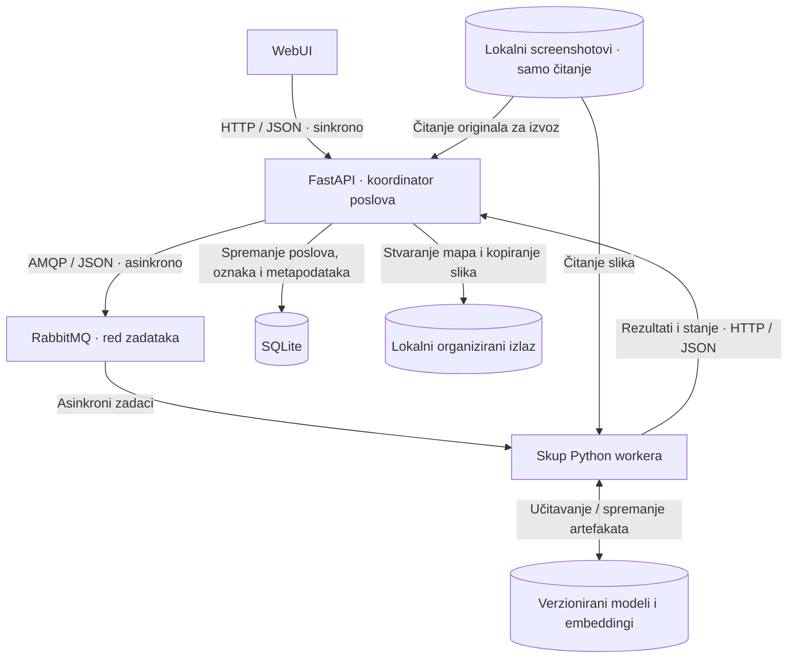

# ScreenshotSort

ScreenshotSort je lokalna web-aplikacija za organiziranje pomiješanih screenshotova videoigara u zasebne mape prema igrama. Korisnik definira igre, označava reprezentativne screenshotove i priprema prilagođeni klasifikator. Neovisni Python workeri paralelno obrađuju preostale slike.

Funkcionalnosti i način korištenja
1. Odabir kolekcije. Korisnik odabire mapu unutar lokalnog ulaznog direktorija konfiguriranog za Docker.
2. Definiranje igara. Postavlja 2–5 kategorija i označava referentne screenshotove za svaku igru ili koristi dostupne početne predloške.
3. Priprema klasifikatora. Relevantni početni primjeri kombiniraju se s korisnikovim referencama te se lokalno trenira mali klasifikator.
4. Razvrstavanje. Korisnik bira igre za izvoz i 1–4 aktivna workera. Prati napredak batcha te može pauzirati, nastaviti ili prekinuti obradu.
5. Pregled rezultata. Ispravlja oznake i pregledava nesigurne predikcije. FastAPI kopira screenshotove u izlazne mape prema igrama; originali ostaju nepromijenjeni.
WebUI sadrži vođeno postavljanje, svijetlu/tamnu temu i upravljački panel za stanje workera, red zadataka, pogreške, ponovne pokušaje i reset profila. Reset uklanja korisničke kategorije i prilagođene modele, uz očuvanje originalnih screenshotova i postojećih izvoza.

## Arhitektura

Jedan Docker Compose projekt pokreće sedam kontejnera: WebUI, API, RabbitMQ i četiri worker kontejnera. Zadano su aktivna dva workera. WebUI mijenja broj uključenih postojećih workera; ne stvara niti uklanja kontejnere. SQLite i datoteke modela koriste lokalnu trajnu pohranu umjesto zasebnih servisa.

RabbitMQ raspoređuje zadatke po slikama. Workeri izdvajaju obilježja i predviđaju oznake; FastAPI je vlasnik upisa u bazu i datotečnih operacija izvoza. Treniranje je zaseban zadatak jednog workera, a svaki batch koristi fiksnu verziju modela. Poruke sadrže identifikatore i reference na datoteke, ne sadržaj slika.
## Tehnologije

| Sloj | Tehnologije |
|---|---|
| WebUI | Bootstrap 5 ili DaisyUI, Vue ili Flask |
| API i koordinacija | Python, FastAPI, asyncio |
| Poruke i komunikacija workera | RabbitMQ |
| Strojno učenje | PyTorch, Hugging Face Transformers / CLIP, scikit-learn |
| Obrada slika i artefakti modela | Pillow, NumPy, joblib |
| Pohrana i pokretanje | SQLite, lokalni bind mountovi / volumei, Docker Compose |

## Strojno učenje
Gotovi CLIP image encoder izdvaja vizualne embeddinge. Njegove težine ostaju nepromijenjene. Na označenim embeddingima trenira se mali klasifikator logističke regresije koji razlikuje konfigurirane igre.

Početno su planirani autorovi istrenirani predlošci za Genshin Impact, The Legend of Zelda: Breath of the Wild i GTA V ( ili druge igre-> vidit ću ). Korisnik može dodati vlastite igre i primjere. Pri izmjeni kategorija ponovno se trenira mali klasifikator na relevantnim postojećim i novim primjerima; CLIP se ne trenira ponovno. Spremljeni klasifikatori i reference koriste se i nakon ponovnog pokretanja.

Nesigurne predikcije izdvajaju se u mapu za provjeru. Prepoznavanje igara izvan konfiguriranih kategorija nije zajamčeno. Točnost ovisi o vizualnoj sličnosti igara te kvaliteti i raznolikosti referentnih slika; nekoliko primjera može biti nedovoljno.
Lokalno korištenje i podaci
Aplikacija je namijenjena lokalnom računalu s Dockerom i Docker Composeom. Postavljanje će obuhvatiti konfiguraciju ulazne/izlazne mape, pokretanje sustava i pristup WebUI-ju na localhostu. Naredbe za instalaciju bit će dokumentirane uz prvu funkcionalnu verziju.

Pregled mapa u WebUI-ju prikazuje direktorije dostupne backendu kroz konfigurirane mountove. Ne daje pristup proizvoljnim mapama računala. PNG/JPEG originali, embeddingi, modeli i rezultati ostaju na Docker hostu; obrada slika ne koristi vanjski AI API. Instalacija može zahtijevati preuzimanje težina modela i ovisnosti.

Izlaz se organizira po batchu i igri, uz zasebnu mapu za provjeru. Pri pauzi već započete slike dovršavaju se prije zaustavljanja novog rada; prekid dodatno otkazuje preostale zadatke. Dovršeni izvozi ostaju sačuvani.

## Opseg raspodijeljenog sustava
Ovo je samostalni projekt za kolegij Raspodijeljeni sustavi na Fakultetu informatike u Puli. Naglasak je na odvajanju zahtjevnog izdvajanja obilježja od API-ja, raspodjeli zadataka i oporavku nakon ispada workera.
- Pouzdanost: trajne poruke, ručne potvrde nakon potvrđenog dovršetka, ograničeni ponovni pokušaji i idempotentni rezultati/izvoz. Izračun se nakon ispada može ponoviti bez dupliciranja konačnih rezultata.
- Mjerenje skaliranja: usporedba 1, 2 i 4 aktivna workera na istom skupu; planirano opterećenje je 1.000 screenshotova do 4K rezolucije. Mjere se vrijeme, propusnost, CPU i RAM te prikazuje oporavak nakon zaustavljanja workera. Rezultati mjerenja još nisu dostupni.
- Ograničenja: jedan lokalni profil i jedan aktivni posao treniranja/razvrstavanja. CPU, memorija, disk, API/izvoz i SQLite mogu ograničiti propusnost; više workera ne jamči proporcionalno ubrzanje.
- Granice izvedbe: neovisni kontejneri rade na jednom fizičkom računalu. Visoka dostupnost API-ja, brokera i pohrane nije dio početnog opsega; za više fizičkih računala trebalo bi omogućiti zajednički ili mrežni pristup slikama i modelima.

#### Autor: Mario Bariša